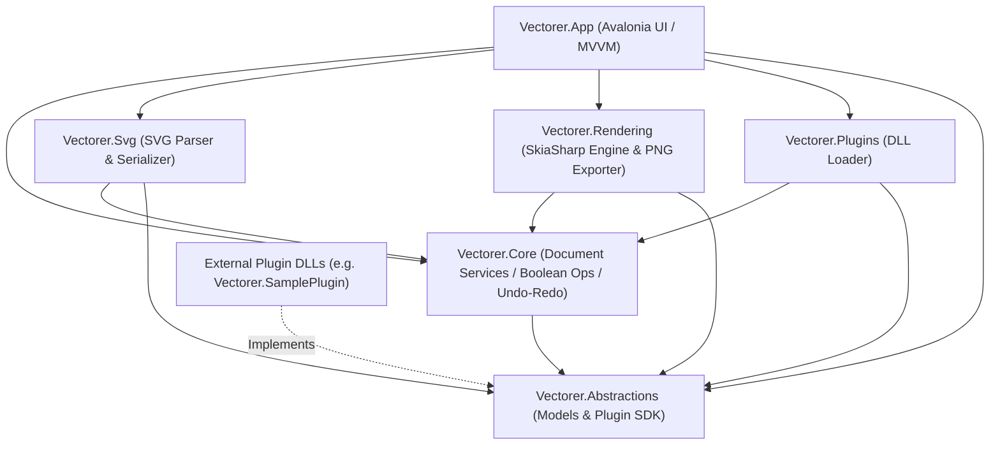

# Vectorer Architecture Design (`ARCHITECTURE.en.md`)

**Languages:** [日本語](ARCHITECTURE.md) | English

This document defines the internal structure, data model (scene graph), path boolean operations, rendering pipeline, and PNG export architecture of Vectorer.

---

## 1. Layered Architecture Overview

---

## 2. Document Model (Scene Graph)

Defined under `Vectorer.Abstractions.Documents`, the scene graph models both standard SVG hierarchy and editor-specific layer and effect concepts:

- **`SvgDocument`**
  - Stores overall canvas dimensions (`Width`, `Height`, `ViewBox`), background color, metadata, and the list of `LayerNode` instances.
- **`SceneNode` (Base Class)**
  - Holds `Id` (string), `Name`, `IsVisible`, `IsLocked`, `Opacity` (`0.0`–`1.0`), `Transform` (`SKMatrix`), `BlendMode` (`LayerBlendMode`), `Filter` (`FilterSettings?`), `ShaderEffect` (`ShaderEffectDescriptor?`), and custom extension attributes (`CustomAttributes`).
- **`ContainerNode` (Abstract : inherits `SceneNode`)**
  - Holds a collection of child nodes (`Children`).
  - **`LayerNode`**: Editor layer unit used for layer blend modes (Overlay, Add, Subtract, etc.) and per-layer batch PNG export.
  - **`GroupNode`**: Maps to standard SVG `<g>` group elements.
- **`ShapeNode` (Abstract : inherits `SceneNode`)**
  - **`Style` (`ShapeStyle`)**:
    - **Fill (`FillPaint`)**: Solid color (`SolidColorFill`) or procedural/image texture (`TextureFill`)
    - **Stroke (`StrokeStyle`)**: Stroke color, `StrokeWidth`, `StrokeCap`, `StrokeJoin`, miter limit, and `DashArray` / offset
  - **Concrete Shape Nodes**:
    - `PolygonShapeNode`: Convex and concave polygons (stores `Points`, plus parametric regeneration properties `PolygonKind`, `Center`, `PointCount`, `OuterRadius`, `InnerRadius`, `StartAngleDegrees` for regular polygons/stars; transitions to `Freeform` upon individual vertex edits)
    - `EllipseShapeNode`: Circles and ellipses (`Center`, `RadiusX`, `RadiusY`)
    - `ArcShapeNode`: Circular/elliptical arcs and pie/chord sectors (`Center`, `RadiusX`, `RadiusY`, `StartAngle`, `SweepAngle`, `CloseMode`)
    - `RectangleShapeNode`: Rectangles and rounded rectangles (`Rect`, `CornerRadiusX`, `CornerRadiusY`)
    - `PathShapeNode`: Arbitrary vector paths (convertible to/from SVG `d` strings and `SKPath`; also represents results of boolean ops and path conversions)
    - `TextShapeNode`: Text nodes (`Text`, font family, size, bold/italic, alignment, letter spacing), supporting outline path conversion via `BuildLocalPath()`
  - Every `ShapeNode` can generate an `SKPath` via `BuildLocalPath()` (and `Transform`-applied `BuildTransformedPath()`).

---

## 3. Boolean Path Operations

Handled by `Vectorer.Core.Geometry.PathBooleanService`.
Takes two or more `ShapeNode` instances (convex/concave polygons, circles, arcs, or arbitrary paths), converts each local `SKPath` into world coordinates by applying its `Transform`, and executes `SkiaSharp.SKPath.Op()`.

| Operation (`BooleanOperationType`) | `SKPathOp` | Description |
| :--- | :--- | :--- |
| `Union` | `SKPathOp.Union` | Combines shapes into a unified outer contour |
| `Difference` | `SKPathOp.Difference` | Subtracts the second shape from the first |
| `Intersection` | `SKPathOp.Intersect` | Extracts only the overlapping region |
| `Xor` | `SKPathOp.Xor` | Combines shapes while cutting out overlapping regions |
| `ReverseDifference` | `SKPathOp.ReverseDifference` | Subtracts the first shape from the second |

Input shapes are ordered back-to-front. Visual attributes (fill, stroke, opacity, blend mode, filter, shader) are inherited from the backmost shape (or the frontmost shape for `ReverseDifference`). The resulting `PathShapeNode` is applied through Undo/Redo commands.

---

## 4. Rendering Pipeline (`Vectorer.Rendering`)

`SkiaDocumentRenderer` renders an `SvgDocument` or specific `SceneNode` onto an `SKCanvas`.

### 4.1 Layers & Blend Mode Compositing
`LayerBlendMode` supports the following modes mapped to `SKBlendMode`:
- `Normal` (`SKBlendMode.SrcOver`)
- `Multiply` (`SKBlendMode.Multiply`)
- `Screen` (`SKBlendMode.Screen`)
- `Overlay` (`SKBlendMode.Overlay`)
- `Add` (`SKBlendMode.Plus`)
- `Subtract` (custom SkSL shader / subtractive compositing)
- `Difference` (`SKBlendMode.Difference`)
- `Darken` (`SKBlendMode.Darken`)
- `Lighten` (`SKBlendMode.Lighten`)

Nodes with `Opacity < 1.0`, `BlendMode != Normal`, or `Filter != null` are composited offscreen via `canvas.SaveLayer(layerPaint)`.

### 4.2 Filters (Blur)
Uses `BlurSigmaX` / `BlurSigmaY` from `FilterSettings` to construct `SKImageFilter.CreateBlur(sigmaX, sigmaY)` and attach it to `SKPaint.ImageFilter`.

### 4.3 Texture Fills & Strokes
- **Texture Fill (`TextureFill`)**: Generates an `SKShader.CreateBitmap(..., SKShaderTileMode.Repeat, SKShaderTileMode.Repeat)` from procedural tile patterns (checkerboard, stripes, crosshatch, dots) or bitmap images and assigns it to `SKPaint.Shader`.
- **Stroke (`StrokeStyle`)**: Combines `SKPaintStyle.Stroke`, `StrokeWidth`, `StrokeCap`, `StrokeJoin`, and `SKPathEffect.CreateDash`.

### 4.4 Per-Object SkiaSharp Shaders (`SKRuntimeEffect`)
Any `SceneNode` can hold a `ShaderEffectDescriptor` (shader ID, SkSL source code, uniform dictionary).
During rendering, `SKRuntimeEffect.CreateShader(sksl, errors)` is compiled (and cached) and evaluated with `SKRuntimeEffectUniforms` including object bounds and custom parameters.

---

## 5. PNG Exporter (`PngExportService`)

`IPngExportService` supports three export modes:

1. **Full Document (`ExportDocumentAsync`)**:
   - Scales the entire document to `TargetWidth` × `TargetHeight` and exports it as PNG.
2. **Selection Only (`ExportSelectionAsync`)**:
   - Computes exact canvas bounds for the selected elements (accounting for ancestor visibility/transforms, fills, stroke width/caps/joins, and blur expansion). Export availability, preview, cropping, and scale base dimensions share this computed bounds and disable export if empty.
3. **Per-Layer Batch Export (`ExportLayersBatchAsync`)**:
   - Iterates through each `LayerNode` (or visible layers only) and writes `{Prefix}_{LayerIndex}_{LayerName}.png` files into the target folder.
