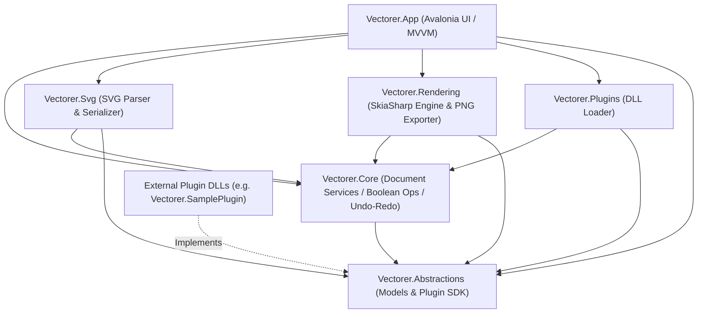

# Vectorer アーキテクチャ設計書 (`ARCHITECTURE.md`)

本ドキュメントでは、Vectorer の内部構造、データモデル（シーングラフ）、図形演算、レンダリングパイプライン、および PNG エクスポートの設計について定義します。

---

## 1. レイヤードアーキテクチャ全体像

---

## 2. ドキュメントモデル（シーングラフ）

`Vectorer.Abstractions.Documents` 名前空間で定義されるシーングラフは、SVG の階層構造とエディタ固有のレイヤー・エフェクト概念を表現します。

- **`SvgDocument`**
  - ドキュメント全体のサイズ (`Width`, `Height`, `ViewBox`)、背景色、メタデータ、および複数の `LayerNode` を保持します。
- **`SceneNode` (基底クラス)**
  - `Id` (文字列)、`Name`、`IsVisible`、`IsLocked`、`Opacity` (0.0〜1.0)、`Transform` (`SKMatrix`)、`BlendMode` (`LayerBlendMode`)、`Filter` (`FilterSettings?`)、`ShaderEffect` (`ShaderEffectDescriptor?`)、カスタム拡張属性 (`CustomAttributes`) を持ちます。
- **`ContainerNode` (抽象クラス : `SceneNode` 継承)**
  - 子ノードのコレクション (`Children`) を保持します。
  - **`LayerNode`**: エディタ上の「レイヤー」単位。レイヤー合成モード（オーバーレイ、加算、減算等）やバッチ PNG 保存の単位になります。
  - **`GroupNode`**: `<g>` 要素に対応するグループ。
- **`ShapeNode` (抽象クラス : `SceneNode` 継承)**
  - **`Style` (`ShapeStyle`)**:
    - **塗りつぶし (`FillPaint`)**: 単色 (`SolidColorFill`)、またはテクスチャ/パターン (`TextureFill`)
    - **アウトライン (`StrokeStyle`)**: 線色、線幅 (`StrokeWidth`)、線端 (`StrokeCap`)、角の形状 (`StrokeJoin`)、破線配列 (`DashArray`)
  - **具象図形クラス**:
    - `PolygonShapeNode`: 凸多角形・凹多角形（頂点リスト `Points` に加え、正多角形・星形のパラメトリック再編集用プロパティ `PolygonKind`, `Center`, `PointCount`, `OuterRadius`, `InnerRadius`, `StartAngleDegrees` を保持。個別頂点編集時に自由多角形 `Freeform` へ移行）
    - `EllipseShapeNode`: 円・楕円 (`Center`, `RadiusX`, `RadiusY`)
    - `ArcShapeNode`: 円弧・扇形 (`Center`, `RadiusX`, `RadiusY`, `StartAngle`, `SweepAngle`, `CloseMode`)
    - `RectangleShapeNode`: 矩形・角丸矩形 (`Rect`, `CornerRadiusX`, `CornerRadiusY`)
    - `PathShapeNode`: 任意のベクターパス（SVG Path Data 文字列 / `SKPath` 変換可能、Boolean 演算やパス変換の結果もこのノードとして表現）
    - `TextShapeNode`: テキスト要素（文字列 `Text`、フォントファミリ、サイズ、太字/斜体、文字揃え、字間を保持し、`BuildLocalPath()` によるアウトラインパス化に対応）
  - すべての `ShapeNode` は `BuildLocalPath()`（および `Transform` 適用済みの `BuildTransformedPath()`）により `SKPath` を生成できます。

---

## 3. 図形論理演算 (Boolean Operations)

`Vectorer.Core.Geometry.PathBooleanService` が担当します。
2つ以上の `ShapeNode`（凸多角形、凹多角形、円、弧、任意パス）を受け取り、それぞれのローカル `SKPath` に `Transform` を適用したワールド座標パスへ変換した上で、`SkiaSharp.SKPath.Op()` を実行します。

| 演算種別 (`BooleanOperationType`) | 対応する `SKPathOp` | 説明 |
| :--- | :--- | :--- |
| `Union` | `SKPathOp.Union` | 2つの図形を結合した外形を作成 |
| `Difference` | `SKPathOp.Difference` | 1つ目の図形から2つ目の図形をくり抜く（差分） |
| `Intersection` | `SKPathOp.Intersect` | 2つの図形が重なっている部分のみを抽出 |
| `Xor` | `SKPathOp.Xor` | 重なっている部分をくり抜いた排他的結合 |
| `ReverseDifference` | `SKPathOp.ReverseDifference` | 2つ目の図形から1つ目の図形をくり抜く |

入力図形は背面から前面の重ね順で扱います。結果の描画属性（塗り、ストローク、不透明度、ブレンドモード、フィルタ、シェーダー）は最背面の図形から、逆差分では最前面の図形から引き継ぎます。演算結果は新しい `PathShapeNode` として生成され、Undo/Redo コマンド経由でドキュメントツリーに反映されます。

---

## 4. レンダリングパイプライン (`Vectorer.Rendering`)

`SkiaDocumentRenderer` が `SvgDocument` または特定の `SceneNode` を `SKCanvas` 上に描画します。

### 4.1 レイヤーとブレンドモード合成
`LayerBlendMode` は以下のモードをサポートし、`SKBlendMode` にマッピングされます：
- `Normal` (`SKBlendMode.SrcOver`)
- `Multiply` (`SKBlendMode.Multiply`)
- `Screen` (`SKBlendMode.Screen`)
- `Overlay` (`SKBlendMode.Overlay`)
- `Add` (`SKBlendMode.Plus` — 加算合成)
- `Subtract` (カスタム SkSL シェーダーまたは減算合成)
- `Difference` (`SKBlendMode.Difference`)
- `Darken` (`SKBlendMode.Darken`)
- `Lighten` (`SKBlendMode.Lighten`)

不透明度 (`Opacity < 1.0`)、ブレンドモード (`BlendMode != Normal`)、またはフィルタ (`Filter != null`) が設定されたノードを描画する際は、`canvas.SaveLayer(layerPaint)` を用いてオフスクリーンバッファで合成します。

### 4.2 フィルタ（ぼかし等）
`FilterSettings` に設定された `BlurSigmaX` / `BlurSigmaY` に基づき、`SKImageFilter.CreateBlur(sigmaX, sigmaY)` を生成して `SKPaint.ImageFilter` に適用します。

### 4.3 テクスチャ塗りつぶしとアウトライン
- **テクスチャ塗り (`TextureFill`)**: タイル模様（チェッカーボード、ストライプ、ドット等のプロシージャルパターン、またはビットマップ画像）から `SKShader.CreateBitmap(..., SKShaderTileMode.Repeat, SKShaderTileMode.Repeat)` を生成し、`SKPaint.Shader` に設定して図形内部を塗りつぶします。
- **アウトライン (`StrokeStyle`)**: `SKPaintStyle.Stroke`、`StrokeWidth`、`StrokeCap`、`StrokeJoin`、`SKPathEffect.CreateDash` を組み合わせて描画します。

### 4.4 オブジェクト単位の SkiaSharp シェーダー (`SKRuntimeEffect`)
各 `SceneNode` は `ShaderEffectDescriptor`（シェーダー ID、SkSL ソースコード、Uniform パラメータ辞書）を保持できます。
レンダリング時に `SKRuntimeEffect.CreateShader(sksl, errors)` をコンパイル（キャッシュ管理）し、オブジェクトのバウンディングボックスや時間/カスタムパラメータを `SKRuntimeEffectUniforms` として渡して描画します。

---

## 5. PNG エクスポーター (`PngExportService`)

`IPngExportService` は以下の3つの出力モードをサポートします：

1. **ドキュメント全体の保存 (`ExportDocumentAsync`)**:
   - 指定された出力サイズ (`TargetWidth`, `TargetHeight`) に合わせてドキュメント全体をスケーリングし、PNG として出力します。
2. **選択したもののみを保存 (`ExportSelectionAsync`)**:
   - 選択要素について、祖先を含む表示状態・変換、塗り、ストロークの線幅・線端・角形状、ぼかしの広がりを反映したキャンバス座標の描画範囲を求めます。出力可否・プレビュー・切り出し・倍率の基準寸法はこの範囲を共有し、範囲が空の場合は出力を無効にします。
3. **レイヤー単位によるバッチ保存 (`ExportLayersBatchAsync`)**:
   - ドキュメント内の各 `LayerNode`（または表示レイヤーのみ）をループし、`{Prefix}_{LayerIndex}_{LayerName}.png` の形式で指定フォルダへ一括出力します。
