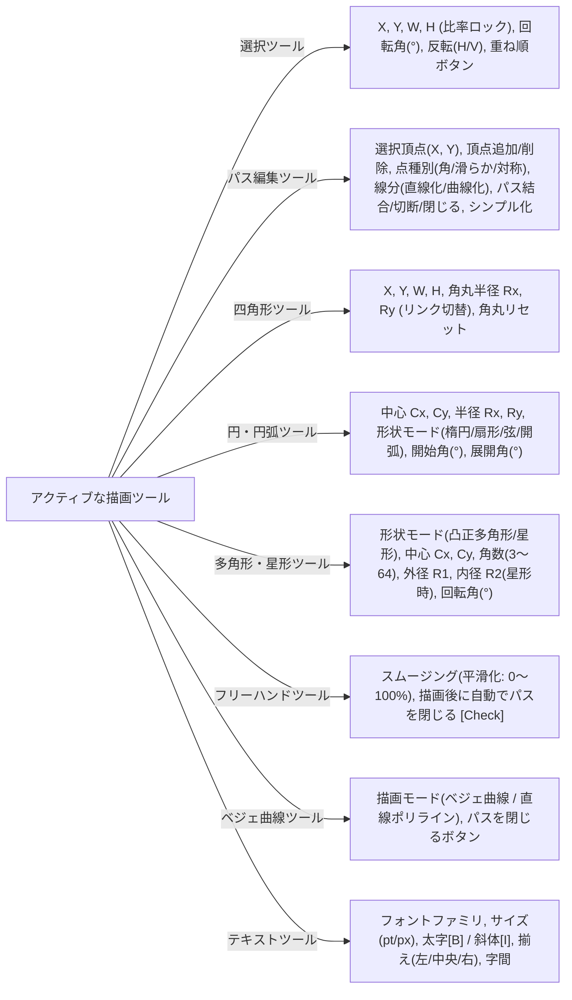
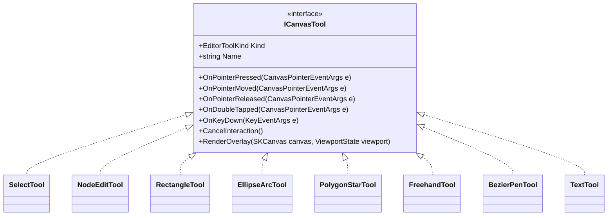

# Vectorer UI / GUI 設計書 (`UI_DESIGN.md`)

本ドキュメントでは、Vectorer（Avalonia UI + SkiaSharp ベースの軽量・高拡張 SVG エディタ）の画面レイアウト、メニュー体系、描画ツール、コンテキストツールバー、インスペクタパネル、状態遷移・入力競合ルール、およびダイアログの仕様を定義します。

---

## 1. 画面レイアウト全体像

**「左：描画ツールボックス」「上：メニューバー＋動的コンテキストツールバー」「中央：インタラクティブキャンバス」「右：ドッキングパネル（インスペクタ＆レイヤーツリー）」「下：ステータスバー」** の5領域で構成します。最小対応ウィンドウサイズは **`1024 × 720 px`**（推奨 `1280 × 800 px` 以上）とします。

```text
+--------------------------------------------------------------------------------------------------+
| [ファイル] [編集] [表示] [レイヤー] [オブジェクト] [パス] [フィルタ・拡張]                 [_][□][X] | <- メニューバー
+--------------------------------------------------------------------------------------------------+
| [ツール別コンテキスト項目: X, Y, W, H / 半径 / 角数 / ノード操作 等] [⋯] | [塗色][線色][線幅][線種] | <- コンテキストツールバー
+------+-------------------------------------------------------------------+-----------------------+
| [選] | [階層: Layer 1 > Group A (Escで戻る)]                             | [塗り＆線] [効果/SkSL]|
| [点] |                                                                   | --------------------- |
| [四] |                                                                   | (選択タブの詳細設定)  |
| [円] |                                                                   |  ・単色 / テクスチャ  |
| [多] |                   中央キャンバス ビューポート                     |  ・線端 / 角 / 破線   |
| [鉛] |              (ズーム・パン・グリッド・操作ギズモ)                 |  ・ぼかし / SkSL      |
| [ペ] |                                                                   |=======================|
| [文] |                                                                   | レイヤー＆オブジェクト|
| ---- |                                                                   | [+] [複製] [削除] [回転]|
| [プ] |                                                                   | ▼ Layer 1 [Overlay]   |
|      |                                                                   |   ├─ Star (Shader)    |
|      |                                                                   |   └─ Hexagon          |
+------+-------------------------------------------------------------------+-----------------------+
| カーソル座標: (240.5, 180.0) | 選択: 1個 | ヒント: ダブルクリックで頂点追加        | ズーム: 100% | <- ステータスバー
+--------------------------------------------------------------------------------------------------+
```

### 各領域の役割

| 領域 | 配置 | 役割 |
| :--- | :--- | :--- |
| **メニューバー** | 最上部 (`DockPanel.Top`) | ファイル入出力、編集、表示、レイヤー操作、オブジェクト配置、パス・論理演算、フィルタ・プラグイン機能への網羅的アクセス |
| **コンテキストツールバー** | メニュー直下 (`DockPanel.Top`) | 左のツールボックスで**現在選択中の描画ツールに応じて動的に切り替わる数値・オプション項目**（幅不足時は `[⋯]` に折りたたみ）と、右端常設のクイック塗り色・線色・線幅設定 |
| **描画ツールボックス** | 左端 (`DockPanel.Left`) | 選択、パス編集（ノード）、基本図形（四角形・円/弧・多角形/星形）、フリーハンド、ベジェ曲線、テキストの切り替え、およびプラグインのワンショットアクションボタン |
| **キャンバスビューポート** | 中央 (`Fill`) | `VectorCanvasControl` による SVG シーングラフ描画、バウンディングボックス／回転ハンドル／ベジェ制御点ギズモのオーバーレイ表示、グループ内編集時のパンくずバー表示 |
| **右ドッキングパネル** | 右端 (`DockPanel.Right`) | **上段**：「塗り＆線」「エフェクト＆シェーダー（ぼかし・SkSL）」のタブ切り替えインスペクタ<br>**下段**（またはタブ切替）：「レイヤー＆オブジェクト階層ツリー」 |
| **ステータスバー** | 最下部 (`DockPanel.Bottom`) | マウス座標、現在の選択情報、操作ヒント、キャンバスのズーム倍率（10%〜3200%）とグリッド/スナップ状態表示 |

---

## 2. 選択・フォーカス・編集中操作の状態遷移表（入力優先度と変更対象）

キー入力の競合やプロパティ変更対象の曖昧さを防ぐため、現在のフォーカス位置・選択状態・操作フェーズに応じた振る舞いを以下の状態表で一意に定義します。

| 状態 / フォーカス | 単一文字キー (`V`,`R` 等) / `Delete` / `Backspace` の行き先 | クイックスタイル＆右インスペクタの表示値と変更対象 | `Esc` キーの動作 |
| :--- | :--- | :--- | :--- |
| **テキスト入力コントロールにフォーカス中**<br>（数値入力欄、レイヤー名変更、キャンバス上のテキスト入力中、SkSL コードエディタ） | **入力コントロールが最優先で消費**（ツール切替やオブジェクト削除は発火しない） | 現在の選択状態（下記）に従う | 入力中の編集をキャンセル（または確定）し、フォーカスをキャンバスへ戻す |
| **キャンバス操作中（ドラッグ中 / ベジェ描画途中）** | 無視（ただし `Shift` / `Alt` 等の修飾キーは制約としてリアルタイム反映） | 操作開始前の状態を表示（ドラッグ中はインスペクタ操作不可） | **進行中のドラッグ変形・描画を破棄**し、操作開始前の状態に戻す（Undo 履歴に積まない） |
| **キャンバス待機中：未選択** | 単一キー：描画ツール切替<br>`Delete` / `Backspace`：何もしない | **次回描画用の規定スタイル (`DefaultCreationStyle`)** を表示・変更する | グループ内編集中なら **1階層親へ戻る**（ルート階層なら何もしない） |
| **キャンバス待機中：単一オブジェクト選択中** | 単一キー：描画ツール切替<br>`Delete` / `Backspace`：選択オブジェクトを削除 | **選択オブジェクトのスタイル**を表示・変更し、変更した属性を `DefaultCreationStyle` にも引き継ぐ（※選択図形を変えずに次の描画色だけ変えたい場合は `Esc` で選択解除してから変更する） | **選択を解除**して「未選択」状態へ遷移する（グループ内階層は維持） |
| **キャンバス待機中：複数オブジェクト選択中** | 単一キー：描画ツール切替<br>`Delete` / `Backspace`：選択中の全オブジェクトを削除 | 全選択図形で一致する属性はその値を表示し、異なる属性は **「混在 (Mixed)」** を表示。**ユーザーが変更した属性（例：線幅のみ）だけを全選択図形に適用し、未操作の属性（各図形の個別色など）は保持する**。変更した属性は `DefaultCreationStyle` にも反映 | **選択を解除**して「未選択」状態へ遷移する |
| **パス編集ツール：頂点（ノード）選択中** | 単一キー：描画ツール切替<br>`Delete` / `Backspace`：**選択中の頂点（アンカーポイント）のみを削除**（全頂点削除時のみ図形自体を削除） | 対象パス図形自体のスタイルを表示・変更 | **頂点の選択を解除**（頂点未選択状態で再度 `Esc` を押すと対象パスの選択を解除） |

---

## 3. メニューバー仕様

すべてのドキュメント変更操作は `IUndoRedoService` (`IDocumentCommand`) を経由し、Undo/Redo の対象となります。すべてのショートカットキーはメニュー間で重複しないよう一意に割り当てます。

### 3.1 ファイル (`File`)
| メニュー項目 | ショートカット | 動作仕様・未保存保護 |
| :--- | :--- | :--- |
| **新規作成...** | `Ctrl+N` | 未保存の変更（`IsDirty == true`）がある場合は先に「保存 / 保存しない / キャンセル」確認ダイアログを表示。その後、新規ドキュメント作成ダイアログを開く |
| **開く...** | `Ctrl+O` | 未保存の変更がある場合は確認ダイアログを表示。`.svg` ファイルを選択し、`SvgSerializer` でパースして読み込む。**ファイル不在や XML/SVG パース失敗時はエラーダイアログを表示し、開いていた元のドキュメント・選択状態・Undo 履歴を一切破壊せずそのまま維持する** |
| **保存** | `Ctrl+S` | 現在のファイルパスへ上書き保存し `IsDirty = false` に更新（未保存の新規文書は「名前を付けて保存」へ遷移） |
| **名前を付けて保存...** | `Ctrl+Shift+S` | ファイル保存ダイアログを開き、標準 SVG + `vectorer:*` 拡張属性付きで保存 |
| **エクスポート (PNG)...** | `Ctrl+Shift+E` | PNG エクスポート専用ダイアログを開く（全体 / 選択要素のみ / レイヤー一括出力） |
| **ドキュメント設定...** | `Ctrl+Shift+P` | 現在のドキュメントのサイズ（`Width`, `Height`, `ViewBox`）や背景色を Undo 可能コマンドとして変更 |
| **終了** | `Alt+F4` | 未保存の変更（`IsDirty == true`）がある場合は「保存 / 保存しない / キャンセル」の確認ダイアログを表示して終了 |

### 3.2 編集 (`Edit`)
| メニュー項目 | ショートカット | 動作仕様 |
| :--- | :--- | :--- |
| **元に戻す (Undo)** | `Ctrl+Z` | 直前の `IDocumentCommand` を取り消す |
| **やり直し (Redo)** | `Ctrl+Y` / `Ctrl+Shift+Z` | 取り消した操作を再実行する |
| **切り取り** | `Ctrl+X` | 選択中のノードをクリップボードへ退避し、ドキュメントから削除 |
| **コピー** | `Ctrl+C` | 選択中のノード（ディープコピー）をクリップボードへ保持 |
| **貼り付け** | `Ctrl+V` | アクティブレイヤー（または現在グループ内編集中の `GroupNode`）にクリップボードのノードを複製追加 |
| **複製** | `Ctrl+D` | 選択中のノードを微小オフセット付きで即座に複製 |
| **削除** | `Delete` / `Backspace` | 選択中のオブジェクト（パス編集時は選択中の頂点ノード）を削除（※テキスト入力欄フォーカス時は文字削除として動作） |
| **すべて選択** | `Ctrl+A` | 現在の編集スコープ（グループ内編集中はそのグループ内、通常時はアクティブレイヤー内）のロックされていない全オブジェクトを選択 |
| **選択を解除** | `Esc` | 第2章の状態表に従い、ドラッグ中断 → 頂点選択解除 → オブジェクト選択解除 → グループ階層復帰の順に段階動作 |

### 3.3 表示 (`View`)
> [!IMPORTANT]
> ズーム操作は図形論理演算とショートカットが競合しないよう `Ctrl+=` (`Ctrl+Plus`) / `Ctrl+-` に割り当てます。**2つ以上の図形を選択している状態でも、ズーム操作によって選択状態や図形形状が変化することはありません。**

| メニュー項目 | ショートカット | 動作仕様 |
| :--- | :--- | :--- |
| **ズームイン** | `Ctrl+=` (`Ctrl+Plus`) | キャンバスの表示倍率を拡大（`Ctrl + マウスホイール上` でも操作可。選択状態は完全に維持） |
| **ズームアウト** | `Ctrl+-` (`Ctrl+Minus`) | キャンバスの表示倍率を縮小（`Ctrl + マウスホイール下` でも操作可。選択状態は完全に維持） |
| **100% 表示** | `Ctrl+1` | ズーム倍率を 100% にリセット |
| **キャンバス全体を表示** | `Ctrl+0` | ウィンドウサイズに合わせてドキュメント全体をフィット表示 |
| **グリッドを表示** | `Ctrl+'` | キャンバス上の補助グリッド線の表示/非表示をトグル |
| **スナップを有効化** | `Ctrl+Shift+;` | グリッド・頂点・バウンディングボックスへの吸着（スナップ）をトグル |

### 3.4 レイヤー (`Layer`)
| メニュー項目 | ショートカット | 動作仕様 |
| :--- | :--- | :--- |
| **新規レイヤー** | `Ctrl+Shift+N` | 新しい `LayerNode` を追加し、アクティブレイヤーに設定 |
| **レイヤーを複製** | - | アクティブレイヤーとその配下ノード一式をディープコピーして複製 |
| **レイヤーを削除** | - | アクティブレイヤーを削除（最後の1枚の場合は空レイヤーを新規作成して最低1枚を維持） |
| **レイヤーの回転** | Submenu | <ul><li>**時計回りに 90° 回転**</li><li>**反時計回りに 90° 回転**</li><li>**180° 回転**</li><li>**左右反転 / 上下反転**</li><li>**角度を指定して回転...**（任意角度の入力ダイアログを表示し、指定した基準点を中心に `LayerNode.Transform` を回転）</li></ul> |
| **合成モード（ブレンド）** | Submenu | アクティブレイヤーの `LayerBlendMode` を切り替え：<br>`Normal` / `Multiply` / `Screen` / `Overlay` / `Add` / `Subtract` / `Difference` / `Darken` / `Lighten` |
| **レイヤーの順序変更** | Submenu | 1つ上へ移動 / 1つ下へ移動 / 最前面へ移動 / 最背面へ移動 |
| **下のレイヤーと結合** | `Ctrl+E` | 直下のレイヤーに子要素を移し、結合後は下のレイヤーの属性を使用します（6.3 節）。直下にレイヤーがない場合、どちらかがロック中の場合、または移動先のワールド変換が非正則な場合は無効化します。 |
| **表示 / ロック切替** | - | アクティブレイヤーの `IsVisible` / `IsLocked` をトグル |

### 3.5 オブジェクト (`Object`)
| メニュー項目 | ショートカット | 動作仕様 |
| :--- | :--- | :--- |
| **グループ化** | `Ctrl+G` | 選択中の複数ノードを `GroupNode` (`<g>`) にまとめる |
| **グループ解除** | `Ctrl+Shift+G` | 選択中の `GroupNode` を展開し、グループの `Transform` を各子要素に合成した上で親コンテナへ戻す |
| **グループ内を編集 / 親階層へ戻る** | `Enter` / `Esc` | 選択中の `GroupNode` の内部編集モード（Isolation Mode）へ入る、または1階層親へ戻る |
| **重ね順** | Submenu | <ul><li>**最前面へ** (`Home`)</li><li>**1つ前面へ** (`PageUp`)</li><li>**1つ背面へ** (`PageDown`)</li><li>**最背面へ** (`End`)</li></ul> |
| **変形** | Submenu | 移動・拡大縮小・回転・傾斜（シアー）の数値指定、および左右反転(`Shift+H`) / 上下反転(`Shift+V`) |
| **整列と分布** | - | 複数選択オブジェクトの左/中央/右揃え、上/上下中央/下揃え、等間隔分布 |

### 3.6 パス (`Path`)
図形のパス化・論理演算・パス形状編集をこのメニューに集約します。ショートカットは表示ズーム（`Ctrl+=` / `Ctrl+-`）と競合しないよう `Ctrl+Shift+...` 系に統一します。
論理演算は形状に適用します。結果の塗り・ストローク・不透明度・ブレンドモード・フィルタ・シェーダーは、選択順にかかわらず重ね順で最背面の図形から引き継ぎます。逆差分は前面から背面を引くため、基準は最前面の図形です。

| メニュー項目 | ショートカット | 動作仕様 |
| :--- | :--- | :--- |
| **オブジェクトをパスに変換** | `Ctrl+Shift+C` | 選択中の基本図形（四角形・円・円弧・多角形/星形）やテキストを `BuildLocalPath()` により `PathShapeNode` へ変換し、自由なベジェ頂点編集を可能にする |
| **ストロークをパスに変換** | `Ctrl+Alt+C` | 選択図形のアウトライン（線幅・破線・線端形状）を塗りつぶし輪郭パス (`SKPaint.GetFillPath`) へ変換して `PathShapeNode` 化する |
| **統合 (Union)** | `Ctrl+Shift+U` | 選択した2つ以上の図形を結合 (`BooleanOperationType.Union`) |
| **差分 (Difference)** | `Ctrl+Shift+D` | 背面の図形から前面の図形をくり抜く (`BooleanOperationType.Difference`) |
| **交差 (Intersection)** | `Ctrl+Shift+I` | 重なっている領域のみを抽出 (`BooleanOperationType.Intersection`) |
| **排他的論理和 (Xor)** | `Ctrl+Shift+X` | 重なり部分をくり抜いて結合 (`BooleanOperationType.Xor`) |
| **逆差分 (Reverse Difference)** | `Ctrl+Shift+R` | 前面の図形から背面の図形をくり抜く (`BooleanOperationType.ReverseDifference`) |
| **パスのシンプル化 (Simplify)** | `Ctrl+L` | `PathShapeNode` の頂点数を削減し、形状を保ったまま滑らかなベジェ曲線・折れ線へ単純化する（許容誤差の調整対応） |
| **パスを閉じる / 開く** | `Ctrl+K` | 選択パスの始点と終点を閉じる (`Close`) または開放する |

### 3.7 フィルタ・拡張機能 (`Filters & Extensions`)
| メニュー項目 | 動作仕様 |
| :--- | :--- |
| **ぼかしフィルタ (Gaussian Blur)...** | 選択オブジェクトまたはレイヤーの `FilterSettings` (`BlurSigmaX`, `BlurSigmaY`) を適用・編集 |
| **フィルタをクリア** | 選択要素のフィルタ設定を解除 |
| **SkSL シェーダーを適用...** | 登録済み `IShaderEffectProvider` の一覧またはカスタム SkSL エディタを開いて適用 |
| **プラグインコマンド一覧** | `IPluginContext.RegisterMenuContribution` で外部 DLL プラグインから登録されたメニュー項目を動的展開 |

---

## 4. 左側ツールボックス（描画ツール選択）とキャンバス操作

左サイドに縦一列のアイコンボタンとして配置し、排他選択（ラジオボタングループ）で現在のアクティブツールを切り替えます。

| 順序 | ツール名 | キー | 生成・操作対象モデル | 主なキャンバス操作挙動 |
| :---: | :--- | :---: | :--- | :--- |
| **1** | **選択ツール**<br>(Select / Transform) | `V` / `S` | 全 `SceneNode` | <ul><li>クリックで単一選択、`Shift+クリック` またはドラッグ矩形（ラバーバンド）で複数選択</li><li>バウンディングボックスの8方向ハンドルで拡大縮小、四隅外側の回転ハンドルで回転</li><li>`GroupNode` をダブルクリックで**グループ内編集モード（Isolation Mode）**へ入る（下記 4.1 節参照）</li></ul> |
| **2** | **パス編集ツール**<br>(Node Editor) | `N` / `A` | `PathShapeNode`<br>`PolygonShapeNode`<br>（基本図形は専用ハンドル操作） | <ul><li>パスのアンカーポイント（頂点）をクリック・範囲選択して移動</li><li>**パス上の線分をダブルクリックで新しい頂点を追加**</li><li>選択した頂点を `Delete` / `Backspace` キーで削除</li><li>ベジェ制御点ハンドル（方向線）をドラッグして曲線の傾き・曲率を編集</li><li>曲線セグメント自体を直接ドラッグして直感的に曲げる</li><li>パラメトリックな正多角形・星形の個別頂点を移動・追加・削除した時点で、自由多角形 (`Freeform`) へ移行する（下記 4.2 節参照）</li></ul> |
| **3** | **四角形ツール**<br>(Rectangle) | `R` | `RectangleShapeNode` | <ul><li>ドラッグで矩形を描画（`Shift` で正方形、`Alt` で中心基準）</li><li>描画後、右上の丸めハンドルをドラッグして角丸半径 (`Rx`, `Ry`) を直感的に調整可能</li></ul> |
| **4** | **円・楕円・円弧ツール**<br>(Ellipse / Arc) | `E` | `EllipseShapeNode`<br>`ArcShapeNode` | <ul><li>ドラッグで楕円を描画（`Shift` で正円、`Alt` で中心基準）</li><li>円周上の開始角・展開角ハンドルをドラッグすると自動的に `ArcShapeNode`（扇形 `PieSlice` / 弦 `Chord` / 開いた弧 `Open`）に切り替わる</li></ul> |
| **5** | **多角形・星形ツール**<br>(Polygon / Star) | `*` / `Y` | `PolygonShapeNode` | <ul><li>中心から外側へドラッグして正多角形（凸多角形）または星形（凹多角形）を描画</li><li>キャンバス上の頂点ハンドルで外径・内径・回転をリアルタイム調整（保存・再読込後もパラメトリック再編集可能）</li></ul> |
| **6** | **フリーハンドツール**<br>(Freehand / Pencil) | `P` | `PathShapeNode` | <ul><li>マウスドラッグの軌跡に沿って自由曲線を描画</li><li>マウスを離した際、コンテキストバーの「スムージング強度」に応じて点列を滑らかなベジェパスへ自動近似</li></ul> |
| **7** | **ベジェ曲線ツール**<br>(Bezier Pen) | `B` | `PathShapeNode` | <ul><li>クリックで折れ線頂点（コーナー点）を配置、ドラッグで方向線（スムーズ曲線点）を引き出しながらパスを構築</li><li>始点をクリックで閉じたパス完成、`Enter` またはダブルクリックで開いたパスとして確定、`Esc` で描画中のパスを破棄</li></ul> |
| **8** | **テキストツール**<br>(Text) | `T` | `TextShapeNode` | <ul><li>キャンバス上をクリックして文字入力カーソルを表示（またはインライン入力ボックス表示）</li><li>「オブジェクトをパスに変換」を実行すると、フォントグリフの輪郭を `PathShapeNode` へ変換可能</li></ul> |
| **9+** | **プラグインアクション** | - | `IToolbarContribution` | ツールボックス下部にセパレータを挟んで配置。**現行 SDK (`IToolbarContribution.Execute`) では選択ツール状態を変えずに即座に実行される「ワンショットアクションボタン」として動作する**（8.3 節参照） |

### 4.1 グループ内編集モード（Isolation Mode）の入り口と出口
- **入り口**：選択ツールで `GroupNode` をダブルクリック（またはメニューから `Enter`）すると、そのグループが現在の「編集スコープ」になります。グループ外の要素は半透明（またはロック状態）で表示され、誤選択を防ぎます。入れ子のグループをさらにダブルクリックして深い階層へ入ることも可能です。
- **階層表示（パンくずバー）**：グループ内編集中は、キャンバス左上に現在の階層パス（例：`📁 Layer 1 > 📦 Group A > 📦 SubGroup`）を示すオーバーレイバーを表示します。
- **出口**：
  1. パンくずバーの任意の親階層名または `[← 戻る]` をクリックする
  2. キャンバス上の何もない空白領域をダブルクリックする
  3. ドラッグしておらず何も選択していない待機状態で `Esc` キーを押す（1階層親へ戻る）

### 4.2 正多角形・星形のパラメトリック保持と自由多角形への移行ルール
- **パラメトリック情報の保存と復元**：
  - `PolygonShapeNode` は頂点配列 `Points` に加え、形状種別 (`PolygonKind`: `Freeform` / `RegularConvex` / `ConcaveStar`) と生成パラメータ（`Center`, `PointCount`, `OuterRadius`, `InnerRadius`, `StartAngleDegrees`）を保持します。
  - SVG 保存時は、他ツール互換のための標準 `<polygon points="...">` 属性と併せて、`vectorer:poly-kind="star"`, `vectorer:points-count="5"`, `vectorer:outer-r="95"`, `vectorer:inner-r="42"`, `vectorer:start-angle="-90"` 等を出力します。
  - これにより、「5角の星形を保存 → 再読み込み → コンテキストバーで内径や角数だけを変更する」という往復編集が可能です。
- **自由多角形 (`Freeform`) への移行**：
  - パス編集ツール（ノードツール）で個別の頂点をドラッグ移動・追加・削除した場合、そのノードの `PolygonKind` は自動的に `Freeform` へ移行します（Undo で元の星形パラメータ状態に戻すことも可能）。
  - `Freeform` になった `PolygonShapeNode` では、角数や内外半径のパラメトリック入力欄は無効化（または非表示）され、純粋な頂点列多角形として扱われます。

---

## 5. 上部コンテキストツールバー（選択ツール連動項目）

メニューバーのすぐ下に配置され、**「左側：現在選択中の描画ツール固有のパラメータ」** と **「右側：全ツール共通のクイック塗り・ストローク設定」** で構成されます。

### 5.1 ツール別の動的パラメータ項目（左側エリア）



#### 各ツールの詳細項目一覧

1. **選択ツール (`Select`)**
   - 座標・サイズ数値入力：`X`, `Y`, `W` (幅), `H` (高さ)、縦横比ロックアイコン (`🔒`)
   - 変形：`回転角 (°)` 入力、左右反転ボタン、上下反転ボタン
   - クイック配置：最前面 / 前面 / 背面 / 最背面ボタン
2. **パス編集ツール (`Node Editor`)**
   - 選択ノード座標：`Node X`, `Node Y`
   - ノード追加・削除：`[＋ 頂点追加]`（選択セグメントの中点に挿入）、`[－ 頂点削除]`
   - ノード種別（傾き制御）：
     - `[コーナー点 (Corner)]`：左右の制御点ハンドルを独立して動かせる鋭角頂点
     - `[スムーズ点 (Smooth)]`：左右の制御点ハンドルが一直線上に連動し、滑らかに繋がる頂点
     - `[対称点 (Symmetric)]`：左右の制御点ハンドルの角度と長さが常に対称になる頂点
   - セグメント操作：`[直線にする]`、`[曲線にする]`
   - パス構造操作：`[2端点を結合]`、`[選択点でパスを切断]`、`[パスを閉じる/開く]`、`[シンプル化]`
3. **四角形ツール (`Rectangle`)**
   - 座標・サイズ：`X`, `Y`, `W`, `H`
   - 角の丸み半径：`Rx`, `Ry`（`Rx=Ry` 連動ロックトグル、`[角丸を0にリセット]` ボタン）
4. **円・楕円・円弧ツール (`Ellipse / Arc`)**
   - 中心・半径：`Cx`, `Cy`, `Rx`, `Ry`
   - モード切替：`[楕円 (Full)]` / `[扇形 (PieSlice)]` / `[弦 (Chord)]` / `[開いた弧 (Open)]`
   - 角度指定（弧モード時活性）：`開始角 (Start °)`、`展開角 (Sweep °)`
5. **多角形・星形ツール (`Polygon / Star`)**
   - モード切替：`[正多角形 (Convex)]` / `[星形 (Concave Star)]`
   - 形状パラメータ：中心 `Cx`, `Cy`、`頂点数 (Sides/Points: 3〜64)`、`外径 (Outer R)`、`内径 (Inner R)`（※星形モード時のみ活性）、`回転角 (°)`
6. **フリーハンドツール (`Freehand`)**
   - `スムージング強度 (0〜100%)` スライダー＋数値、および `[終点を始点に繋げて閉じる]` トグル
7. **ベジェ曲線ツール (`Bezier Pen`)**
   - モード切替：`[標準ベジェ曲線]` / `[直線ポリライン]`、`[現在のパスを閉じる]` ボタン
8. **テキストツール (`Text`)**
   - `フォント選択 ComboBox`、`サイズ数値`、`[B (太字)]`、`[I (斜体)]`、テキスト配置（`左揃え` / `中央揃え` / `右揃え`）、`文字間隔 (Letter Spacing)`

### 5.2 全ツール共通のクイックスタイル項目（右側エリア）
コンテキストバーの右端に常設します。表示値と変更対象は **第2章の状態遷移表** に従います（未選択時は `DefaultCreationStyle`、単一選択時は対象図形＋`DefaultCreationStyle`、複数選択時は一致値または「混在 (`--`)」表示で操作した属性のみ全選択図形へ適用）。

- **塗りつぶし (Fill)**：カラースウォッチボタン（クリックでカラーピッカー＋「なし / 単色 / テクスチャ」簡易ポップアップ。複数選択で色が異なる場合は斜線/混在アイコンを表示）
- **ストローク色 (Stroke)**：カラースウォッチボタン（クリックでカラーピッカー＋「線なし / 単色」切替）
- **ストローク太さ (Width)**：数値スピンボックス（`px`。混在時は空欄プレースホルダー `--` を表示し、入力確定時のみ全選択図形の線幅を更新）
- **ストローク種類 (Dash)**：ドロップダウン（実線 / 破線 / 点線 / 一点鎖線）

### 5.3 狭いウィンドウ幅での表示優先順（オーバーフロー対応）
ウィンドウ幅が最小対応幅（`1024px`）付近まで狭まった場合、コンテキストツールバーの項目が切れないよう以下の優先順で表示し、収まらない低頻度項目は `[⋯ (その他)]` ドロップダウンメニューへ自動的に折りたたみます。

1. **優先度1（常時表示）**：主要座標・寸法パラメータ（`X, Y, W, H` / `Cx, Cy, Rx, Ry` / `Node X, Y` / 角数・半径 / フォント＆サイズ）および右端のクイックスタイル（塗色・線色・線幅）
2. **優先度2（幅があれば表示）**：モード切替・頻用操作（角丸半径、開始角/展開角、ノード追加/削除、コーナー/スムーズ/対称切替、太字/斜体）
3. **優先度3（幅不足時に `[⋯]` へ格納）**：メニューバーからも実行可能な補助アクション（反転ボタン、重ね順ボタン、直線化/曲線化、2端点の結合、パス切断、パスを閉じる、シンプル化、ストローク線種）

---

## 6. 右側ドッキングパネル（インスペクタ＆レイヤーツリー）

右サイドバーは上下2分割（スプリッターで高さ比率調整可、またはタブ化切替可）とし、**上段に「選択オブジェクトのプロパティ・エフェクト詳細」**、**下段に「レイヤー＆オブジェクト階層ツリー」** を配置します。

### 6.1 上段タブ①：塗り＆ストローク詳細 (`Fill & Stroke`)
コンテキストバーのクイック設定では収まらない詳細な描画スタイルを編集します。変更対象ルールは第2章の状態表と共通です。

- **塗りつぶし (`FillPaint`)**
  - 塗り種別選択：`なし (None)` / `単色 (Solid Color)` / `テクスチャパターン (Texture Fill)`
  - **単色設定時**：RGBA カラーピッカー、HEX コード入力 (`#RRGGBBAA`)、不透明度スライダー
  - **テクスチャ設定時 (`TextureFill`)**：
    - パターン種別 (`TexturePatternKind`)：`Checkerboard`（市松模様）、`DiagonalStripes`（斜めストライプ）、`Dots`（ドット）等
    - メインカラー (`PrimaryColor`) / サブカラー (`SecondaryColor`)
    - パターンスケール (`Scale`: `4px`〜`128px` スライダー)
- **ストローク詳細 (`StrokeStyle`)**
  - 線色 (`Color`)、線幅 (`StrokeWidth`)
  - 線端の形状 (`StrokeCap`)：`Butt`（平端） / `Round`（丸端） / `Square`（突出端）
  - 角の形状 (`StrokeJoin`)：`Miter`（留め継ぎ） / `Round`（丸継ぎ） / `Bevel`（面取り）
  - カスタム破線配列 (`DashArray`)：プリセット選択または `8, 4, 2, 4` のようなカンマ区切り数値指定

### 6.2 上段タブ②：エフェクト＆シェーダー (`Effects & Shaders`)
Vectorer の特徴であるブレンド合成、フィルタ、および `SkiaSharp` (`SKRuntimeEffect` / SkSL) シェーダーをオブジェクト単位・レイヤー単位で編集します。

- **合成・不透明度**
  - 不透明度 (`Opacity`: `0%`〜`100%`)
  - ブレンドモード (`BlendMode`: `Normal`, `Multiply`, `Screen`, `Overlay`, `Add`, `Subtract`, `Difference`, `Darken`, `Lighten`)
- **ガウスぼかしフィルタ (`FilterSettings`)**
  - 有効化チェックボックス
  - 水平ぼかし強度 (`BlurSigmaX`: `0.0`〜`100.0`) / 垂直ぼかし強度 (`BlurSigmaY`: `0.0`〜`100.0`)（縦横連動ロック付き）
- **SkSL シェーダーエフェクト (`ShaderEffectDescriptor`)**
  - シェーダー選択ドロップダウン：`なし` / プラグイン登録シェーダー一覧 (`IShaderEffectProvider`) / `カスタム SkSL`
  - **動的 Uniform スライダー群**：選択されたシェーダーの `DefaultUniforms` に定義された各パラメータ（時間、周波数、カラー比率など）をスライダー＋数値入力として自動生成
  - **ライブ SkSL エディタ（折りたたみ式）**：SkSL コードを直接編集・コンパイルし、コンパイルエラーがある場合は行番号付きで下部に赤字表示

### 6.3 下段パネル：レイヤー＆オブジェクト階層ツリー (`Layers & Objects`)
ドキュメント内の `LayerNode` と、その配下の `GroupNode` / `ShapeNode` を1つのツリービュー (`TreeView`) として表示・操作します。

```text
+---------------------------------------------------+
| レイヤー＆オブジェクト      [+] [複製] [回転] [🗑] |
| 合成: [Normal       ▼]   不透明度: [=======] 100% |
+---------------------------------------------------+
| 👁 🔓 ▼ 📁 Layer 1 [Normal] |
+---------------------------------------------------+
```

- **パネル上部バー**：
  - `[＋ 新規レイヤー]`、`[レイヤー複製]`、`[レイヤー回転ポップアップ (90°/-90°/180°/角度指定)]`、`[削除]`
  - 選択中レイヤー（またはノード）の**合成モード（ブレンドモード）ドロップダウン**と**不透明度スライダー**
- **ツリー各行の操作**：
  - **表示切替アイコン (`👁`)**：`IsVisible` のトグル
  - **ロック切替アイコン (`🔒`)**：`IsLocked` のトグル（ロック中はキャンバス上で選択・移動不可）
  - **ノード名**：ダブルクリックでインライン名前変更 (`Name`)
  - **バッジ表示**：通常以外のブレンドモード名（`[Add]`, `[Overlay]` 等）や、フィルタ・シェーダー適用中バッジ（`[fx]`）を表示
  - **ドラッグ＆ドロップ**：レイヤーの上下順序入れ替え、オブジェクトの別レイヤー・別グループへの移動、重ね順変更

#### 親の変更時の座標とレイヤー結合時の属性
1. **ツリーでの別レイヤー／別グループへのドラッグ移動**：
   - 移動元コンテナ（親レイヤーや親グループ）に回転や拡大縮小 (`Transform`) が設定されている場合でも、**移動後のノードがキャンバス上で同じ位置・角度・大きさを維持するよう**、移動前のワールド変換行列 $M_{\text{world}} = M_{\text{oldParent}} \times M_{\text{child}}$ から移動先コンテナの逆行列を掛けて新しいローカル変換行列 $M'_{\text{child}} = M_{\text{newParent}}^{-1} \times M_{\text{world}}$ を再計算して設定します（移動先のワールド変換が非正則で逆変換できない場合は移動を無効化）。
2. **下のレイヤーと結合**
   - 上のレイヤーの子要素を重ね順どおりに下のレイヤーの最前面へ移し、上のレイヤーを削除します。各子要素のローカル変換を上記の式で補正し、キャンバス上の位置・角度・大きさと子要素自身のスタイルを保ちます。
   - 結合後のレイヤー名、表示状態、不透明度、ブレンドモード、フィルタ、シェーダーは下のレイヤーの設定を使用します。上のレイヤー固有の合成設定はそのレイヤーとともに破棄します。たとえば下のレイヤーが不透明度50%なら、移した図形を含むレイヤー全体に50%を適用します。Undo 1回で元の両レイヤーとその属性・子要素を復元します。

---

## 7. ダイアログ仕様

### 7.1 PNG エクスポートダイアログ (`PngExportDialog`)
`[ファイル] -> [エクスポート (PNG)...]` (`Ctrl+Shift+E`) から起動し、`IPngExportService` の3つのモードを1つの画面でシームレスに扱います。

```text
+-----------------------------------------------------------------------+
| PNG エクスポート                                                  [X] |
+-----------------------------------------------------------------------+
| 出力対象モード:                                                       |
|  (●) ドキュメント全体   ( ) 選択中の要素のみ   ( ) レイヤー別一括出力 |
+-----------------------------------+-----------------------------------+
| [出力設定]                        | [プレビュー]                      |
|  基準寸法:      860 x 540 px      |   +---------------------------+   |
|  幅 (Width):    [ 1720 ] px  [🔒] |   |                           |   |
|  高さ (Height): [ 1080 ] px       |   |     (透過チェッカー＋     |   |
|  スケール倍率:  [1x] [2x*] [4x]   |   |      レンダリング画像)    |   |
|                                   |   +---------------------------+   |
|  [x] 背景を透過する               |     出力サイズ: 1720 x 1080 px    |
|                                   |                                   |
| (※レイヤー一括出力時のみ表示)     |                                   |
|  ファイル名接頭辞: [ export_    ] |                                   |
|  [x] 非表示レイヤーを除外する     |                                   |
+-----------------------------------+-----------------------------------+
|                                        [キャンセル]  [エクスポート...] |
+-----------------------------------------------------------------------+
```

1. **ドキュメント全体 (`ExportDocumentAsync`)**：基準寸法を `(Document.Width, Document.Height)` とし、指定した出力サイズで全体を1枚の PNG に出力。
2. **選択中の要素のみ (`ExportSelectionAsync`)**：
   - 選択要素をキャンバス座標で描画した範囲を出力領域とします。祖先を含む表示状態・変換、塗り、ストロークの線幅・線端・角形状、ぼかしの広がりを反映し、同じ領域を出力可否の判定・プレビュー・PNGの切り出し・倍率の基準寸法に使います。
   - 選択が0件または描画範囲が空なら「出力可能な選択要素がありません」と表示し、出力ボタンを無効にします。線幅4 pxの水平線を単独で選択した場合は出力でき、丸い線端やぼかしの端までプレビューとPNGに収まります。
3. **レイヤー別一括出力 (`ExportLayersBatchAsync`)**：保存先フォルダを選択し、`{Prefix}_{LayerIndex}_{LayerName}.png` の形式で各レイヤーを個別の PNG ファイルとしてバッチ出力。出力対象レイヤーが 0 枚（すべて非表示かつ「非表示レイヤーを除外」がオン）の場合もボタンを無効化します。
4. **寸法入力とスケール倍率 (`1x` / `2x` / `4x`) の連動仕様**：
   - 倍率プリセットボタン（`0.5x`, `1x`, `2x`, `4x`）を押すと、常に現在のモードの **「元の基準寸法 (`BaseWidth`, `BaseHeight`)」** に対して `Round(BaseWidth * Scale)`、`Round(BaseHeight * Scale)` で幅・高さを再計算します。
   - 幅または高さを手動入力した場合は、手入力したピクセル値を優先（縦横比ロック `🔒` がオンならもう一方も連動計算）し、倍率表示は `カスタム (例: 1.5x)` 状態に切り替わります。
   - プレビュー下部に表示される出力ピクセル寸法と、実際に保存される PNG の解像度は常に完全一致させます。

### 7.2 新規作成 / ドキュメント設定ダイアログ (`DocumentPropertiesDialog`)
- **プリセット選択**：カスタム、アイコン (`64×64`, `256×256`, `512×512`)、HD (`1280×720`)、FHD (`1920×1080`)、4K (`3840×2160`)、A4 縦/横
- **サイズ設定**：`Width (px)`, `Height (px)`、縦横入れ替えボタン
- **背景設定**：透過背景（キャンバス上はチェッカーボード表示）または背景色 (`BackgroundColor`) 指定

### 7.3 レイヤーの角度指定回転ダイアログ (`RotateLayerDialog`)
- **回転角度 (`Degrees`)**：`-360°`〜`+360°` の数値入力＋スライダー（リアルタイムプレビュー対応）
- **回転中心**：`キャンバスの中心` または `レイヤー内要素のバウンディングボックス中心` を選択

---

## 8. ドメインモデルおよび MVVM・プラグインアーキテクチャとの接続設計

本 UI 設計をクリーンに実装するため、`Vectorer.Abstractions`、`Vectorer.Core`、`Vectorer.App` 間で以下の責務分担を行います。

### 8.1 ドメインモデル・サービスの拡張項目 (`Vectorer.Abstractions` / `Vectorer.Core`)
- **`PolygonShapeNode` のパラメトリック属性保持**：
  - `PolygonKind` (`Freeform`, `RegularConvex`, `ConcaveStar`)、`Center`, `PointCount`, `OuterRadius`, `InnerRadius`, `StartAngleDegrees` を保持し、再計算メソッド `RegeneratePoints()` と自由多角形への移行メソッド `ConvertToFreeform()` を提供。
- **`TextShapeNode` の追加 (`Vectorer.Abstractions.Documents`)**：
  - プロパティ：`Text` (文字列)、`Position` (`SKPoint`)、`FontFamily`、`FontSize`、`IsBold`、`IsItalic`、`TextAlign`、`LetterSpacing`
  - `BuildLocalPath()`：`SKFont` / `SKPaint` からテキストアウトラインの `SKPath` を生成することで、既存の `PathBooleanService`（論理演算）や「オブジェクトをパスに変換」と完全に統合。
- **パス操作サービスの拡充 (`Vectorer.Core.Geometry`)**：
  - `ObjectToPath(ShapeNode)`：任意の `ShapeNode` から `BuildLocalPath()` を呼び出し、スタイルと `Transform` を引き継いだ `PathShapeNode` を生成。
  - `StrokeToPath(ShapeNode)`：`SKPaint.GetFillPath()` を用いてストローク輪郭を塗りパス化した `PathShapeNode` を生成。
  - `SimplifyPath(PathShapeNode, float tolerance)`：Ramer-Douglas-Peucker アルゴリズムおよびベジェ曲線フィッティングにより、パスの頂点数を削減。

### 8.2 ツールコントローラ設計 (`Vectorer.App.Tools`)
キャンバス上のマウスイベント（`PointerPressed`, `PointerMoved`, `PointerReleased`, `DoubleTapped`）を `MainWindowViewModel` に直接肥大化させず、ツールごとの Strategy パターンで分離します。



- 各ツールはドラッグ中のプレビュー枠やバウンディングボックス、アンカーポイント、ベジェ方向線ハンドルを `RenderOverlay()` でキャンバス上に描画します。
- 操作確定時（マウスリリースや Enter 確定時）に `IDocumentCommand` を生成し、`IEditorWorkspace.ExecuteCommand()` を通じて Undo/Redo スタックへ記録します。

### 8.3 プラグインツールボタン (`IToolbarContribution`) とカスタム描画ツールの境界
- **現行 SDK での動作（ワンショットアクション）**：
  - `Vectorer.Abstractions.Plugins.IToolbarContribution` は `Execute(IEditorWorkspace workspace)` を持つコマンド実行インターフェースです。
  - ツールボックス下部（またはメニュー）に表示されるプラグイン項目をクリックした際は、現在のアクティブな描画ツール（選択ツールやペンツールなど）を切り替えることなく、その場で `Execute(workspace)` を呼び出してドキュメント操作やエフェクト適用を完結させます。
- **将来拡張（インタラクティブなプラグイン描画ツール）**：
  - 外部 DLL プラグインからマウスドラッグやリアルタイムプレビューを伴う独自の描画ツールを追加する場合は、Avalonia UI 型に依存しない `CanvasPointerEvent`（ワールド座標、ボタン・修飾キー状態）と `SKCanvas` オーバーレイ描画を受け取る `IPluginCanvasTool` インターフェースを `Vectorer.Abstractions.Plugins` に追加して対応します。
